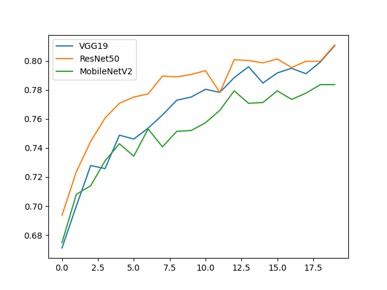
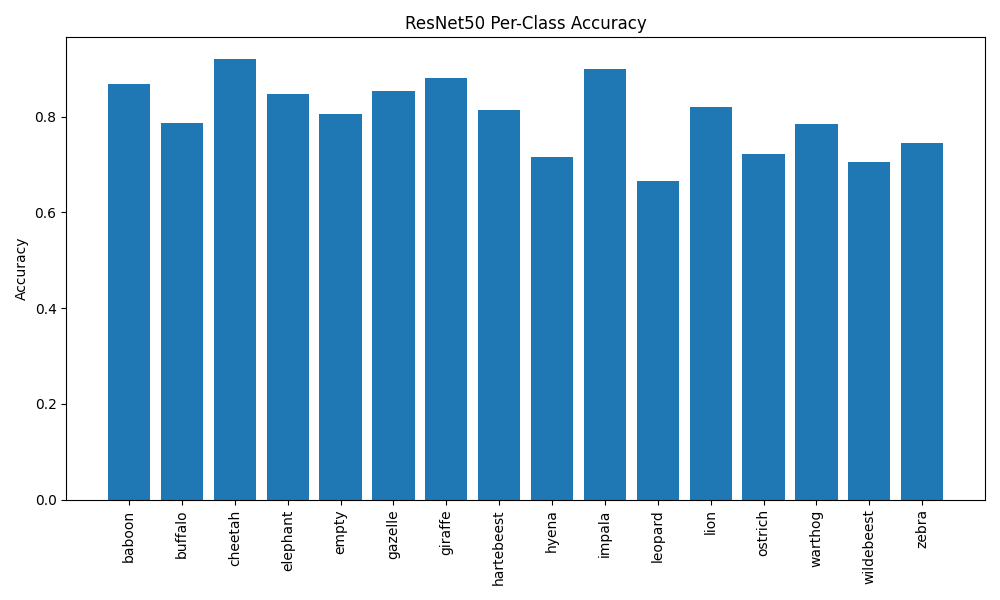
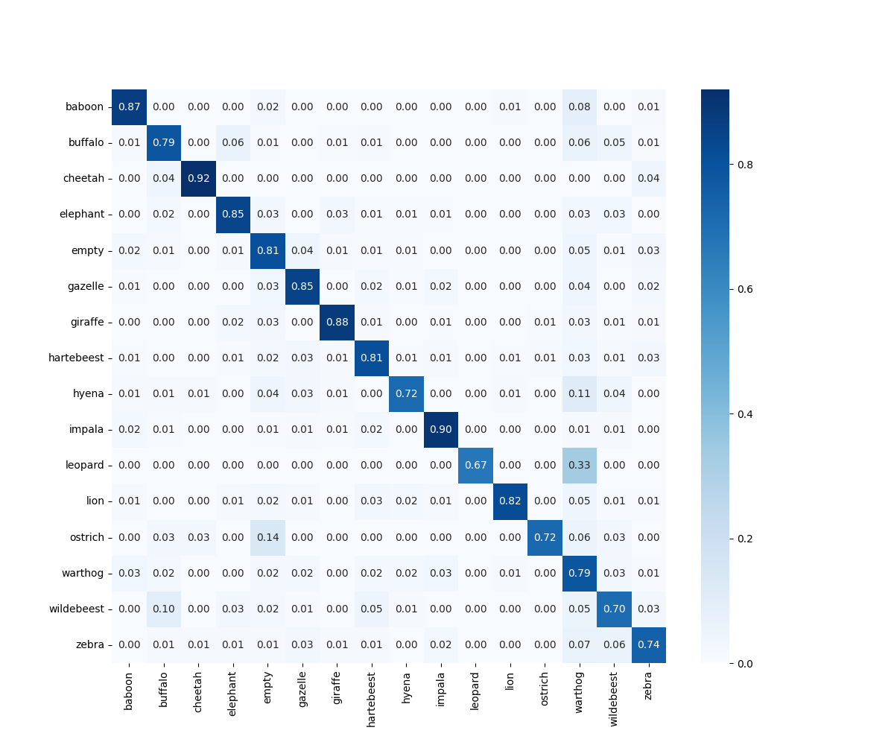

# Snapshot Serengeti Wildlife Classification

This project implements a **deep learning benchmarking framework** to automatically classify animal species from the **Snapshot Serengeti (Season 8)** dataset. The study compares three distinct **Convolutional Neural Network (CNN)** architectures—**VGG-19**, **ResNet-50**, and **MobileNetV2**—to evaluate their **classification performance** and **computational efficiency** for ecological monitoring and conservation use cases.

---

## Performance Summary

Validation results from the training logs (`*_log.csv`) and the notebook's classification reports (1,867 validation images). **ResNet-50** and **VGG-19** tie on accuracy, and **MobileNetV2** trades about 2.7 points of accuracy for the fastest inference.

| Model        | Val. accuracy | Val. loss | Inference (ms/image) | Parameters* | Best use case |
|--------------|---------------|-----------|----------------------|-------------|---------------|
| **ResNet-50**   | **81.09%** | **0.6535** | 6.12 | ~25M  | Highest accuracy at moderate cost; wildlife census |
| **VGG-19**      | 81.04%     | 0.6830 | 7.53 | ~144M | Matches ResNet-50 but slowest and heaviest; research baseline |
| **MobileNetV2** | 78.36%     | 0.7315 | **5.23** | ~3.4M | Battery-powered edge devices and real-time inference |

\* Standard ImageNet backbone sizes.

---

## Getting Started

### 1. Prerequisites

Ensure the following are installed on your system:

- Python 3.9  
- TensorFlow / Keras  
- Microsoft **AzCopy**

---

### 2. Data Acquisition (AzCopy)

To optimize storage usage, this project uses a **targeted download strategy**. Instead of downloading the full **~450 GB** Snapshot Serengeti dataset, only **daytime imagery** is retrieved using a curated file list (`daytime_training_list.txt`), reducing the footprint to approximately **17 GB**.

Metadata can be dowloaded from "https://storage.googleapis.com/public-datasets-lila/snapshotserengeti-v-2-0/SnapshotSerengeti_S1-11_v2_1.json.zip"

#### Download Command

```bash
# Syntax for downloading specific files listed in your .txt file
azcopy copy \
"https://lilawildlife.blob.core.windows.net/lila-wildlife/snapshotserengeti-v-2-0/SnapshotSerengeti_S08_v2_0_part1.zip" \
"./data2/snapshotserengeti-unzipped" \
--list-from "daytime_training_list.txt"
```

Download the metadata JSON above alongside the images; the notebook uses it to map each image to its species label.

### 3. Run the benchmark

```bash
pip install tensorflow pandas numpy matplotlib seaborn scikit-learn jupyter
jupyter notebook benchmarking.ipynb
```

The notebook fine-tunes each backbone, logs training to CSV and writes the comparison charts to `imgs/`.

---

## Results

| Accuracy comparison | Per-class accuracy |
|---|---|
|  |  |



**Takeaway:** ResNet-50 gives the best accuracy (81.1%) and is faster than VGG-19, which reaches the same accuracy at a much higher cost. MobileNetV2 is the edge option: about 7× smaller and the fastest at inference, for 2.7 points less accuracy.

---

## Repository contents

| Path | Description |
|------|-------------|
| `benchmarking.ipynb` | Data pipeline, training and evaluation of all three models |
| `daytime_training_list.txt` | Curated list of daytime images for the targeted AzCopy download |
| `vgg19_training_log.csv`, `resnet50_baseline_log.csv`, `mobilenet_baseline_log.csv` | Per-epoch training logs |
| `imgs/` | Architecture diagrams, accuracy charts and the confusion matrix |

## Tech stack
Python · TensorFlow/Keras · VGG-19 · ResNet-50 · MobileNetV2 · AzCopy · pandas · scikit-learn
